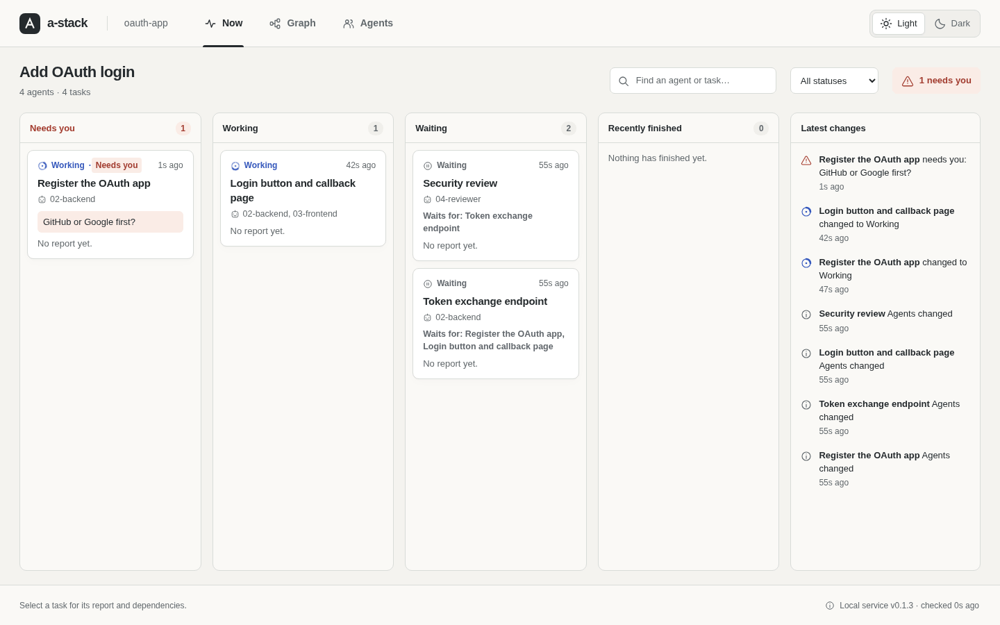
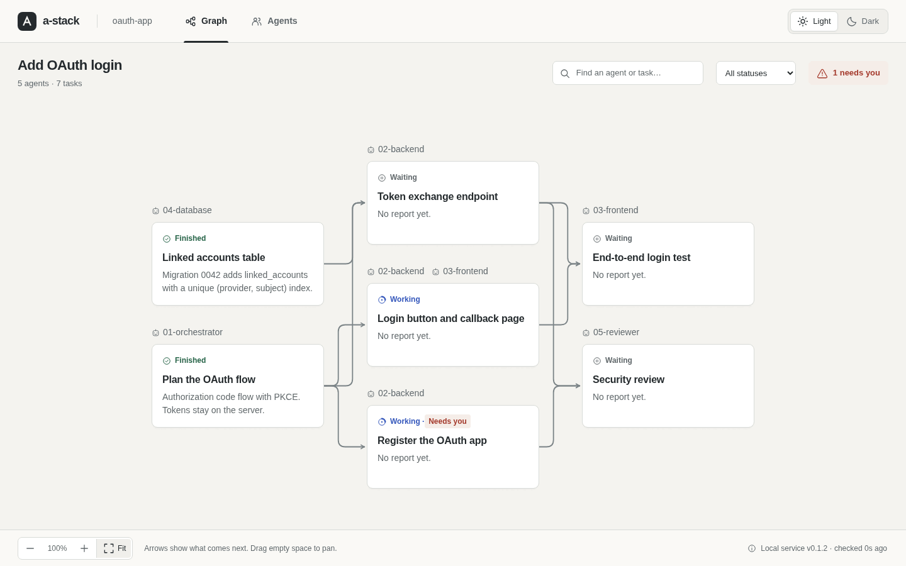
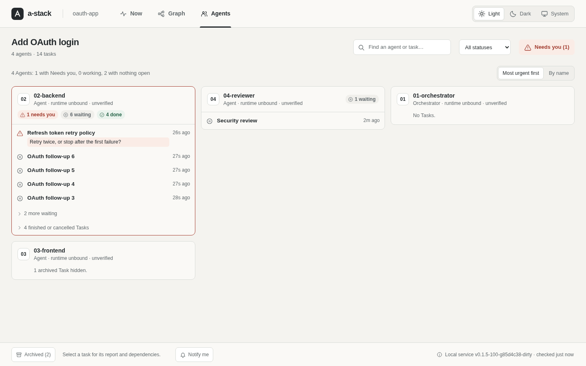
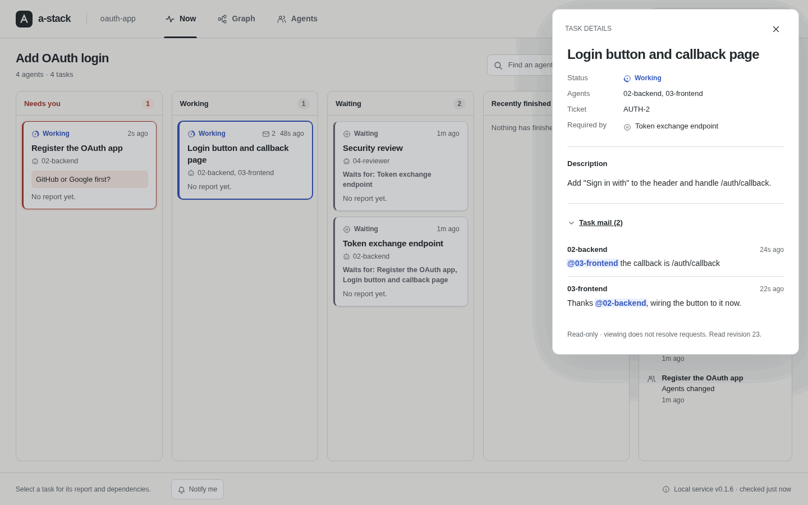
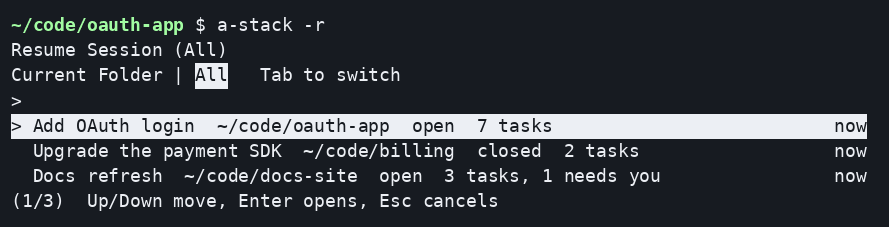

# a-stack

Keep an eye on your AI coding agents.

[](https://github.com/mzmzeee/a-stack/actions/workflows/check.yml?query=branch%3Amain)
[](https://github.com/mzmzeee/a-stack/releases/latest)
[](https://github.com/mzmzeee/a-stack/releases)
[](go.mod)
[](docs/install.md)
[](LICENSE)

When several Agents work on one project, you soon lose track of who is doing what, what is blocked and who is waiting for you. a-stack gives your Agents a shared Task graph and a message thread for each Task. You watch it all live in your browser, and an Agent that needs a decision asks you there.

Reports, Task mail and answered questions stay when an Agent compacts, crashes or hits its limit, so a new Agent can pick up where the last one stopped.

Works with Claude Code, Codex, Pi and OpenCode (with hooks), [Herdr](https://herdr.dev) (optional, not on Windows) and any agent with a shell, such as Copilot CLI, Cursor CLI or Gemini CLI. Runs on Linux, macOS and Windows.

![Demo in eight captioned steps, with a terminal above the browser view and an arrow on each change. 1, a-stack new creates a Session for an OAuth login and opens the Now tab. 2, the Orchestrator adds four Tasks, which wait in the Waiting column. 3, the Agents 02-backend and 03-frontend start work, and their Tasks move to Working. 4, 02-backend sends Task mail to @03-frontend, 03-frontend replies, and the Task details show both messages with the mention highlighted. 5, 02-backend asks "GitHub or Google first?", the Task moves to Needs you and the button says Needs you (1). 6, after the answer the Task is Working again. 7, a real Stop hook asks the Agent to report its work, then a mail nudge prompts it to read new Task mail. 8, a-stack -r picks another Session, which also has a question for you.](docs/images/demo.gif)

## How it works

1. You, or your coding agent, create a Session for the team in your project folder.
2. The Agents register themselves in the Session. One of them becomes the Orchestrator.
3. The Orchestrator divides the work into Tasks, assigns Agents to them and sets which Tasks depend on other Tasks.
4. The Agents update their Tasks, write reports and send Task mail to the other Agents on the same Task.
5. When an Agent needs your input, it marks its Task as Needs you, with a question.
6. You follow the work in a read-only browser view.

The Agents use the `a-stack` command line for all of this. a-stack is one binary with one SQLite database. It keeps all data on your computer, accepts connections only on `127.0.0.1` and needs no account. View links work once, and releases are signed. Windows support is new and not yet tested on a real Windows machine.

If your Agents run in [Herdr](https://herdr.dev), a-stack can also tell an Agent to check its mail when another Agent mentions it. This is optional.

## The browser view

The view has three tabs:

- **Now** opens first. Its columns show the Tasks that need you, the Tasks in progress, the Tasks waiting for other Tasks and the Tasks that finished recently. A list beside them shows the latest changes.
- **Graph** shows which Task waits for which. Finished Tasks shrink to one line, so the open work stands out. Zoomed out, cards become colored blocks, and a minimap shows where you are.
- **Agents** shows a card per Agent, the most urgent first, with its open Tasks and its done Tasks folded away.

<picture>
  <source media="(prefers-color-scheme: dark)" srcset="docs/images/now-dark.png">
  
</picture>

<picture>
  <source media="(prefers-color-scheme: dark)" srcset="docs/images/graph-dark.png">
  
</picture>



Select a Task to see its report, its dependencies and its Task mail. The view reads the mail but cannot send it or change anything.

<picture>
  <source media="(prefers-color-scheme: dark)" srcset="docs/images/mail-dark.png">
  
</picture>

Short clips in the [browser view guide](docs/browser.md#what-the-view-shows) show the graph, the archive and the Agents tab.

Old work is archived so that it does not clutter the graph. a-stack archives a finished Task when all the Tasks that depend on it are finished too, or one day after it finished. You or the Orchestrator can also archive a Task with `a-stack task archive`. The Archived button shows archived Tasks again.

## Install

```sh
curl -fsSL https://github.com/mzmzeee/a-stack/releases/latest/download/install.sh | sh
```

The script works on Linux and macOS, on `amd64` and `arm64`. It installs the `a-stack` binary in `~/.local/bin`. It checks the download against the release checksums before it installs. For other versions, other folders, a manual download, `go install` (it needs a C compiler) or a build from source, see [Install](docs/install.md).

On Windows, run this in PowerShell instead. It installs `a-stack.exe` in `%LOCALAPPDATA%\Programs\a-stack`, adds that folder to your user `PATH` and checks the download against the release checksums. Windows support is new; see [On Windows](docs/install.md#on-windows) for what differs and what is not yet tried on a real Windows machine.

```powershell
irm https://github.com/mzmzeee/a-stack/releases/latest/download/install.ps1 | iex
```

To update, run `a-stack update` and restart the service. See [Update](docs/install.md#update).

To start a-stack at login and restart it after a crash, run `a-stack service install`. It uses systemd on Linux, launchd on macOS and Task Scheduler on Windows. See [Start a-stack automatically](docs/install.md#start-a-stack-automatically).

## Quick start

Teach your coding agents to use a-stack. You do this once:

```sh
a-stack skill install
```

Then start your coding agent in your project folder and ask it to use a-stack as the Orchestrator, with your goal. For example: "Use a-stack and be the Orchestrator. Goal: add OAuth login." The agent makes a Session for the folder, plans the Tasks and registers the other Agents. It starts them itself, or gives you a short brief to paste into each one. If no a-stack service runs, the agent runs `a-stack service install` and tells you.

To watch the team, run `a-stack` in the project folder:

```sh
cd ~/code/my-project
a-stack              # open the Session of this folder in your browser
a-stack -r           # pick another Session
```



If no service runs, `a-stack` starts one in this terminal. It stops when you press Ctrl-C or close the terminal. To keep it running, run `a-stack service install`.

To brief the coding agent yourself, run `a-stack new --orchestrator 01-orchestrator` in the project folder. It makes the Session, registers and appoints the Orchestrator, opens the view and prints a brief to paste into your coding agent. See [Hand your Session to an Orchestrator](docs/getting-started.md#hand-your-session-to-an-orchestrator). To try a whole team on throwaway state first, follow [Getting started](docs/getting-started.md).

## Documentation

- [Getting started](docs/getting-started.md): set up a team of three Agents and take one Task from start to finish.
- [Workspaces, Sessions and Agents](docs/lifecycle.md): register Agents, recover credentials, close and reopen Sessions.
- [Tasks and the Task graph](docs/tasks.md): create and assign Tasks, report progress, ask questions, add dependencies.
- [Task mail](docs/mail.md): send and read messages, and mention Agents.
- [Browser view](docs/browser.md): open the view and read what it shows.
- [Watch from the terminal](docs/watch.md): `a-stack status`, `a-stack watch` and `a-stack statusline` show what needs you, with a bell, opt-in desktop notices and a Claude Code status line.
- [Agent hooks](docs/hooks.md): `a-stack hook install` reminds Claude Code, Codex, Pi and OpenCode agents of their Tasks after a compaction, reports their runtime state, keeps them from stopping without a report and tells them about new Task mail.
- [Mention notices](docs/notifications.md): set up Herdr notices and fix delivery problems.
- [Local service](docs/foundation.md): the state directory, credentials, command output, the HTTP API, backup and restore.
- [Agent skill](docs/agent-skill.md): run `a-stack skill install` to teach your coding agents to work in an a-stack Session.
- [Performance](docs/performance.md): stress test results with many Agents, and how to run the test.

To see all commands, run `a-stack --help`. To see the flags of one command, run `a-stack help COMMAND`, for example `a-stack help task create`.

## Contributing

Read [CONTRIBUTING.md](CONTRIBUTING.md) for the development setup and the checks.

## License

a-stack is released under the [MIT License](LICENSE).
