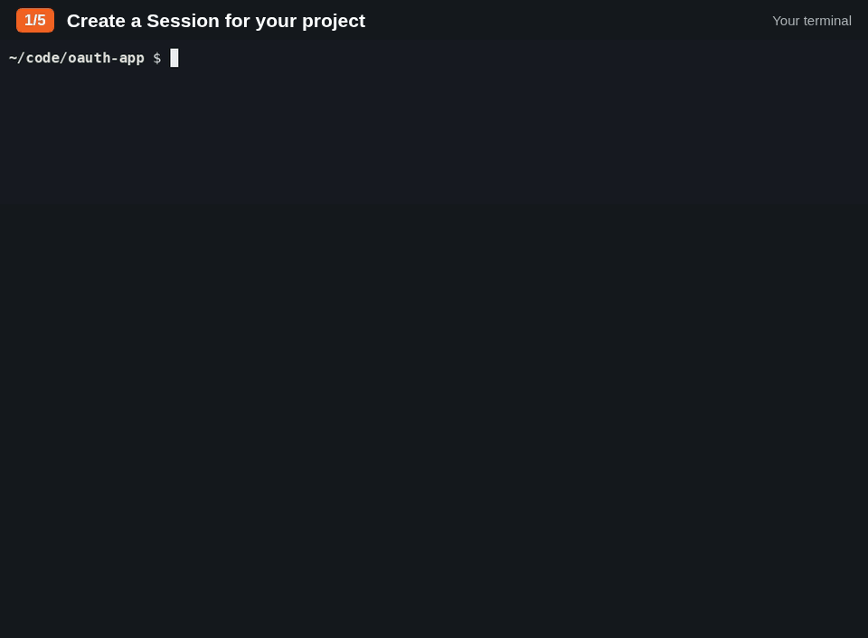

# a-stack

Keep an eye on your AI coding agents.

[](https://github.com/mzmzeee/a-stack/actions/workflows/check.yml?query=branch%3Amain)
[](https://github.com/mzmzeee/a-stack/releases/latest)
[](https://github.com/mzmzeee/a-stack/releases)
[](go.mod)
[](docs/install.md)
[](LICENSE)

When several Agents work on one project, you soon lose track of who is doing what, what is blocked and who is waiting for you. a-stack gives your Agents a shared Task graph and a message thread for each Task. You watch it all live in your browser, and an Agent that needs a decision asks you there.



## How it works

1. You start the a-stack service and create a Session for the team.
2. The Agents register themselves in the Session. One of them becomes the Orchestrator.
3. The Orchestrator divides the work into Tasks, assigns Agents to them and sets which Tasks depend on other Tasks.
4. The Agents update their Tasks, write reports and send Task mail to the other Agents on the same Task.
5. When an Agent needs your input, it marks its Task as Needs you, with a question.
6. You watch the Task graph and the Agents in a read-only browser view.

<picture>
  <source media="(prefers-color-scheme: dark)" srcset="docs/images/graph-dark.png">
  
</picture>

The Agents use the `a-stack` command line for all of this. a-stack is one binary with one SQLite database. It runs on Linux, keeps all data on your computer and accepts connections only on `127.0.0.1`.

If your Agents run in [Herdr](https://herdr.dev), a-stack can also tell an Agent to check its mail when another Agent mentions it. This is optional.

The Agents tab shows the same Tasks in one row for each Agent:


## Install

```sh
curl -fsSL https://github.com/mzmzeee/a-stack/releases/latest/download/install.sh | sh
```

The script installs the `a-stack` binary in `~/.local/bin`. It checks the download against the release checksums before it installs. For other versions, other folders, a manual download or a build from source, see [Install](docs/install.md).

To update, run the same command again and restart the service. See [Update](docs/install.md#update).

To start a-stack at boot and restart it after a crash, see [Start a-stack automatically](docs/install.md#start-a-stack-automatically).

## Quick start

```sh
cd ~/code/my-project
a-stack new          # first time: creates a Workspace and a Session and opens the view
a-stack              # later: opens your last Session
a-stack -r           # pick another Session
```

If no a-stack service runs yet, these commands start it in the terminal and keep it running until you press Ctrl-C. If the service already runs, for example as a [systemd service](docs/install.md#start-a-stack-automatically), they use it and return.

The Task graph is empty at first. To register Agents and give them Tasks, follow [Getting started](docs/getting-started.md).

## Documentation

- [Getting started](docs/getting-started.md): set up a team of three Agents and take one Task from start to finish.
- [Workspaces, Sessions and Agents](docs/lifecycle.md): register Agents, recover credentials, close and reopen Sessions.
- [Tasks and the Task graph](docs/tasks.md): create and assign Tasks, report progress, ask questions, add dependencies.
- [Task mail](docs/mail.md): send and read messages, and mention Agents.
- [Browser view](docs/browser.md): open the view and read what it shows.
- [Mention notices](docs/notifications.md): set up Herdr notices and fix delivery problems.
- [Local service](docs/foundation.md): the state directory, credentials, command output, the HTTP API, backup and restore.

To see all commands, run `a-stack --help`. To see the flags of one command, run `a-stack help COMMAND`, for example `a-stack help task create`.

## Contributing

Read [CONTRIBUTING.md](CONTRIBUTING.md) for the development setup, the checks and the design records.

## License

a-stack is released under the [MIT License](LICENSE).
