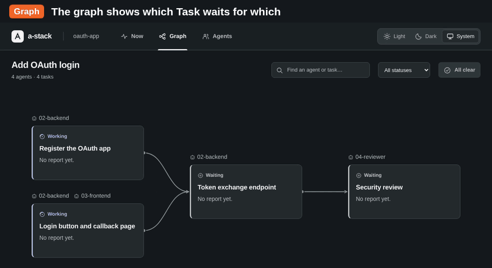
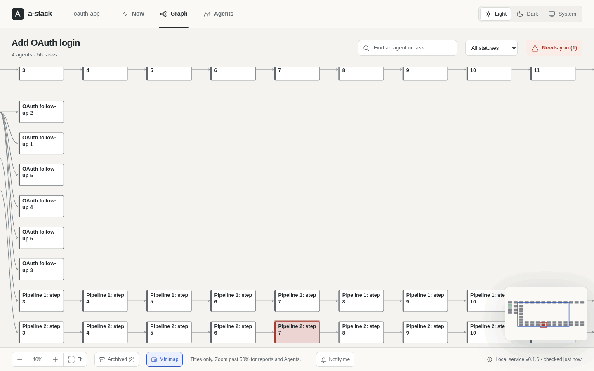
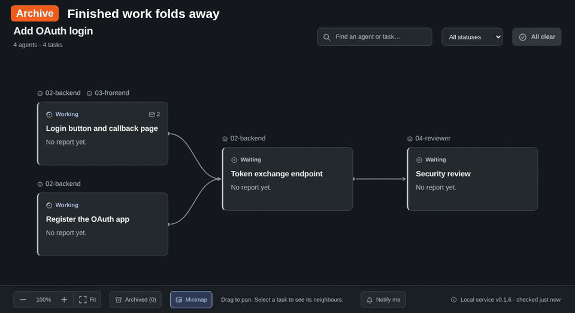
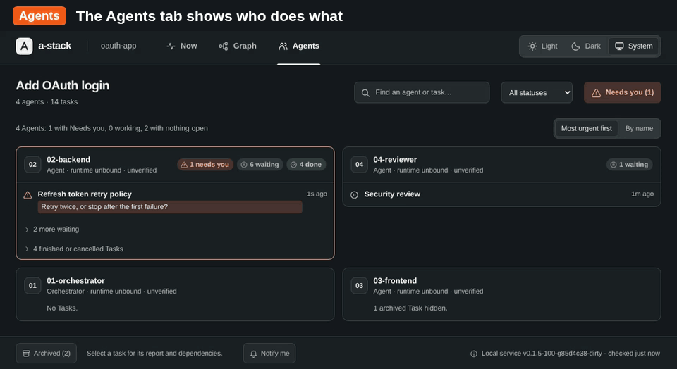

# Browser view

The browser view shows one Session: its Task graph, its Agents and the details of each Task. It is read-only. It shows the Task mail of a Task, but it cannot send mail or change anything.

## Open the view

The view needs a running service: a user service set up with [`a-stack service install`](install.md#start-a-stack-automatically), or `a-stack serve` in a terminal. The [shorter commands](#open-the-last-session) start one for you when none runs. To open one Workspace and Session by its IDs:

```sh
a-stack open --workspace WORKSPACE_ID --session SESSION_ID
# Print the URL, but do not start the browser:
a-stack open --workspace WORKSPACE_ID --session SESSION_ID --no-browser --json
```

`open` accepts the usual `--state-dir`, `--credential-file` and `--as` flags. Only the Operator can open the view, also for a closed Session. With an Agent credential, `open` fails with `forbidden`, because the view reads the Task mail of every Task in its Session. The view reads the Session metadata and that Task mail. It cannot open another view, send or check mail, or use the write, storage or runtime endpoints.

`open` prints the URL before it starts the browser with `xdg-open` on Linux, `open` on macOS, or the default browser of Windows (through `ShellExecute`). If that fails, the command still succeeds, the URL is on stdout, and stderr shows a fixed message. Open a printed URL within a minute: it works once, for 60 seconds (see [Keep the URL private](#keep-the-url-private)). With `--json`, the output is `{"data":{"url":"..."}}`.

## Open the last Session

The Operator has three shorter commands. They need no IDs:

```sh
a-stack              # open the last Session
a-stack -r           # pick a Session in the terminal (also --resume)
a-stack new [NAME]   # make a Session for the current folder and open it
```

They act as the Operator with `operator.json` in the state directory. They accept `--state-dir`, `--no-browser` and `--json`, but no credential flags. Each one opens the view the same way as `open`: a new one-time link, the same browser launch and the same fixed message when the launch fails. Before the URL, it prints the name and folder of the Session that it opens. With `--json`, the `data` object also has `workspace_id`, `workspace_path`, `session_id`, `session_name` and `current_folder`.

If no service answers for the state directory, the command starts the service in the foreground first, with the same checks and lock as `serve`. It prints a line with the service URL and a line that says how to keep it running with `a-stack service install` (with `--json`, only the same ready line as `serve`), opens the view, and keeps the service running until Ctrl-C, SIGTERM or SIGHUP. SIGHUP comes when you close the terminal, so the service still shuts down cleanly and removes `service.json`. A hint or a failed step does not stop the service. The error goes to stderr. If another `serve` holds the state directory lock but does not answer yet, because it is still starting or hangs, the command says so and exits with 3. To use `--listen` or `--herdr-executable`, start `serve` yourself.

### How `a-stack` picks the Session

The service has no single "last changed" time for a Session. The command uses the latest `updated_at` of the Session itself and of its Tasks. Agent, dependency and mail changes do not count. The command reads all Sessions and their Task lists to find this time.

1. It looks for the Workspace of the current folder: the Workspace whose folder is the current folder or the nearest parent of it.
2. If that Workspace has an open Session, the command opens its most recently changed open Session.
3. If not, it opens the most recently changed open Session of all Workspaces.

The output says whether the Session belongs to the current folder. When there are other open Sessions, the output gives their number and points to `a-stack -r` (in JSON, `other_open_sessions`). If no Session exists, the command prints a hint to run `a-stack new` (in JSON, `{"data":{"hint":"..."}}`) and exits with 0. If all Sessions are closed, the hint points to `a-stack -r`.

### Pick a Session with `a-stack -r`

The picker lists all Sessions, newest change first, also closed ones. Each row shows the Session name, the Workspace folder (with `~` for your home folder), open or closed, the number of Tasks and of Needs you requests, and the age of the last change, such as `7m`, `2h` or `1d`.

- It starts with the Sessions of the current folder. Tab switches between Current Folder and All. Without a Workspace for the current folder, it starts with All.
- Type to filter by Session name or folder. Case does not matter.
- Up and Down, or Ctrl-P and Ctrl-N, move the selection. Enter opens the selected Session. Esc or Ctrl-C cancels.

The picker uses raw terminal input and plain ANSI escapes, and it restores the terminal when it ends, also on SIGINT, SIGTERM, SIGHUP or SIGQUIT. Names and folders are shown with control characters replaced, so a Session name cannot change the terminal. If stdin or stdout is not a terminal, or with `--json`, `a-stack -r` prints `{"data":{"folder":"...","sessions":[...]}}` instead and opens nothing.

### Make a Session with `a-stack new`

`a-stack new` uses the Workspace whose folder is exactly the current folder, after it resolves symlinks. If there is none, it creates one. Then it creates a Session named NAME, or named after the folder. Then it opens the view.

If that Workspace already has an open Session with the same name, `a-stack new` makes no second one. It says so and opens the existing Session (in JSON, `"existing_session":true` and no `session_operation_id`). To make another Session in the same folder, give it a new name: `a-stack new NAME`. A closed Session of the same name does not count; to open it, run `a-stack -r`.

a-stack asks the caller to make the operation IDs. Here the CLI is the caller: it makes a random ID (`cli-` and 22 characters) for each change and prints it, in JSON as `workspace_operation_id` and `session_operation_id`. If the outcome of a change is unknown, the error names the command and the operation ID to send the same change again.

## Keep the URL private

The URL is a view link, `/view/WORKSPACE_ID/SESSION_ID#CODE`. The code in the fragment is a one-time secret. The client makes the code and an operation ID, and sends only the code's SHA-256 hash to `POST /v1/browser/open`. The service stores the hash and a scalar retry receipt. It never stores the code.

The code works once, within 60 seconds after `open`. The page reads it from the fragment at once, removes the fragment with `history.replaceState` and sends the code to `POST /v1/browser/redeem`. This request has the same `Host`, `Origin` and `X-A-Stack-Instance` checks as the others, but no bearer token. The service deletes the code and returns a view token for the Session. It stores only the token's hash. The page keeps the view token in the tab's session storage, so you can reload the tab.

A view token works for 30 days. Then, after [`view revoke`](#revoke-view-access), or after a restore from a backup made before the view was opened, the page says that the view lost access and to run `a-stack` to open it again. A link that was already used or is older than 60 seconds shows "This link has expired or was already used". In both cases, run `a-stack` or `a-stack open` for a new link. Opening the same link in a second tab fails, because the first tab used the code. A new tab without a fragment has no access. If you open a new link in a tab, the tab uses the new view token.

So a link in the browser history, in the command line of `xdg-open` or `open`, or in a screenshot is useless after a minute. The view token is never in a URL. The page sends it only in the `Authorization` header of data requests to the same origin. It is never in request paths, query strings, assets or logs. The Operator credential never reaches the page.

Each `open` makes a new link, and each new link deletes the expired links and view tokens. A lost response can leave a link that nobody uses; it expires. There is no automatic retry. A direct API caller keeps the same operation ID and hash for a matching retry.

### Revoke view access

```sh
a-stack view revoke --workspace WORKSPACE_ID --session SESSION_ID
a-stack view revoke --all
```

`view revoke` deletes the view tokens and unused links of one Session, or of every Session with `--all`. Only the Operator can run it. Open tabs lose access at their next refresh, within 30 seconds, and say so. The command prints `{"data":{"revoked":N}}`, where N is the number of view tokens it deleted. The endpoint is `POST /v1/browser/revoke` with `workspace_id` and `session_id`, or with `"all":true`.

## What the view shows

The view is HTML, CSS, JavaScript and SVG, embedded in the binary. It has three tabs, Now, Graph and Agents, and three theme buttons: Light, Dark and System. Now is the default tab, and System the default theme: the view follows the light or dark setting of your system, also from the first paint, without a light flash. The view remembers the tab that you last used and the theme that you pick in the browser's local storage, so they stay after a browser restart. The storage belongs to the view's address, so a service on a new port starts again from the defaults.

- The header shows the name of the Workspace folder next to a-stack, for example `my-project`. It comes from the snapshot's `workspace_name`, which is only the last part of the Workspace path, so the home directory never appears in the view or in screenshots. The name is hidden in narrow windows.
- When the Workspace has [standing orders](lifecycle.md#standing-orders), a collapsed "Standing orders" line under the header shows them as plain text when you open it. The view cannot change them.
- A shared Task shows the same data in the card of each of its Agents. The Unassigned card shows Tasks with no assignee.
- Cards and Agent rows with Task mail show an envelope and the number of messages, such as ✉ 12, at the right of the status line. Screen readers hear it as "12 Task mail messages". Compact blocks in the Graph leave it out.
- Progress and Needs you requests are shown separately. The Needs you button in the header counts the open requests, such as "Needs you (2)", or says "All clear". When several Tasks need input, it opens a chooser: oldest request first, each with its title, the first part of the question and the age of the last change. Viewing a Task never resolves its request.
- The chooser buttons keep their identity across unrelated refreshes. If the focused request is resolved somewhere else, the focus moves to a remaining choice, or to the view tab when the chooser is empty.
- In a window lower than 600px or narrower than 700px, such as a phone or a browser at 200% zoom, the whole page scrolls. Only the tabs stay at the top. In the Graph tab, the footer with the zoom controls stays at the bottom; on Now and Agents, it is at the end of the page.
- The runtime state has an "unverified" label and the age of its last observation. The age increases also when polls succeed.

### Now

The Now tab answers what is happening and what needs you, without panning. It has four columns and a feed:

- Needs you: Tasks with an open Needs you request, with the question.
- Working: Tasks in progress.
- Waiting: Tasks that have not started. When a Task waits on prerequisites that are not finished, the card names up to three of them, such as "Waits for: X, Y, Z +7 more".
- Recently finished: finished and cancelled Tasks that are not [archived](tasks.md#archived-tasks), newest first. "Show archive (N)" adds the archived Tasks below them, dimmed. "Hide archive" removes them again.
- Latest changes: the most recent changes, newest first. Each shows the Task title (two lines at most), the change on its own line, such as "Changed to Finished" or "Reported: …", and its age. The icon shows the kind of change: a status, a report, file references, Agents, a new Task, an edit, Needs you or the archive.

A Task with an open request is in Needs you, whatever its progress. Its card there shows the progress without a Needs you label, because the column, the red ring and the question already say it. Each card shows the status, the Task mail count, the title, the assigned Agents, the first line of the latest report and the age of the last change, such as `2m ago` or `3h ago`. Inside a column, the newest change comes first. An empty column says so in one line. A long column scrolls inside itself. A Session with no Tasks says so and suggests to brief an Orchestrator with the a-stack skill. "Clear filters" shows only when a search or a status filter is set. Click a card, or press Enter on it, to open the details. Search and the status filter work on the board and on the feed.

The feed uses the Task's last action (`last_action`) at its `updated_at`, the report time `report_at`, and the differences that the page sees between two polls: progress changes and Needs you requests set or resolved. A change that is not the latest one of its Task shows only if the page was open when it happened. When two changes of one Task come between two polls, the feed shows the time of the later one for both. The page keeps up to 300 changes in memory and shows the latest 12.

A poll moves cards between columns in place. The selection, the focused card and the scroll positions stay.

### Graph

- Graph arrows point from a prerequisite to its dependent Task. The details also name both directions.
- Full names wrap above the cards.
- Every card, also on the Now tab, has a left border in its status color: blue for Working, grey for Waiting, green for Finished and light grey for Cancelled. A Task that needs you has a red border and a red ring, so it stands out also at a small zoom.
- The graph runs left to right with one column per dependency rank. A Task without prerequisites sits one column before its first dependent, so its lines do not cross a column. Three ordering passes put each Task near the Tasks it connects to. Each Task is centered on the lines from its prerequisites, so a chain runs level, and moves down only to keep 28px between cards.
- A line is a curve from the output port of a card to the left side of the next card. It ends in a small arrowhead. Only a Task with lines out has an output port, a dot on the right edge of the card.
- Finished and cancelled Tasks are compact blocks: the Agent names, then one line with the status icon and the muted title, two lines at most. They have no status label and no report preview; the details show both. Hover a block to see its full title. Compact blocks keep 16px between them. A Task that needs you keeps its full card.
- Tasks without a line sit in rows below or in columns to the right of the connected graph, whichever lets Fit show them larger.
- The graph hides a dependency line when another path already connects the two Tasks; the details panel lists every dependency.
- The graph hides [archived Tasks](tasks.md#archived-tasks) by default. Finished and cancelled Tasks that are not archived stay, so the finished work that a live Task depends on and the last Task of each chain are visible. Lines to or from a hidden archived Task are not drawn, so a Task whose prerequisites are all archived sits in the first column. A full card says how many of its prerequisites are archived and hidden. The Archived (N) toggle in the footer of the Graph and Agents tabs shows them again, dimmed. The view remembers the toggle in local storage. The service decides which Tasks are archived; the view cannot archive anything.
- Select a Task, with a click or with Enter, to focus it. Its lines turn the accent color, get thicker and move on top of the others. Its direct prerequisites and dependents stay bright. Other cards fade: they take the background color, their titles turn grey and their status border turns grey, but their text keeps its contrast. A Task that needs you never fades. Other lines fade to 22%. Lines that the graph hides because another path connects the Tasks appear dashed while one of their Tasks has the focus. The focus and the accent outline of the Task stay after the details close. Escape, or a click on empty space, clears it.
- Below 50% zoom, each card becomes a block with a tinted fill and a left bar in its status color, and shows only its title, at the same size on screen at every zoom, cut to the lines that fit. The Agent names, the report and the caption are hidden. Below 30%, the blocks show no text: a block is then too narrow for more than one cut word. A Task that needs you keeps a red ring. The blocks keep the size and place of the cards, so zooming never runs the layout again. With forced colors, such as Windows High Contrast, the blocks keep their borders, Needs you has a double border, and the lines use the text color.
- A minimap at the bottom right of the graph, 200×130 pixels (140×91 on a phone), shows every card as a block in its status color, with a ring around Needs you, and a box around the part you see. Click or drag on it to move the view there. It is hidden while the whole graph fits the panel. The Minimap button in the footer of the Graph tab, or `m` in the graph, turns it off or on. The button shows which, also while the graph fits, and the view remembers it in local storage. The minimap is for the pointer only: screen readers skip it, and it never takes the focus.
- The layout runs again when Tasks or dependencies change, when the Archived toggle changes, or when a card changes size: a new title, a Task that becomes finished or cancelled or opens again, other assigned Agents, Needs you, file references, cancelled prerequisites or hidden archived prerequisites. It uses the panel size at that moment. Resizing the window alone does not move cards, and neither does a poll without changes, a new report or a change between Waiting and Working.







### Agents

The Agents tab shows one card per Agent, in a grid of columns at least 400px wide. A line on top sums them up, such as "15 Agents: 4 with Needs you, 11 working, 1 with nothing open".

- The card header has the Agent's name, whether it is the Orchestrator, its runtime state (unverified, with its age), and chips that count its Tasks, such as "1 needs you · 3 working · 7 waiting · 1 done".
- Each Task is one row: the status icon, the title (two lines at most), the Needs you question, "with" and the other Agents of a shared Task, the Task mail count and the age of the last change. A click opens the details.
- Needs you and Working Tasks always show. Waiting shows its 4 newest Tasks, then "3 more waiting". With 5 waiting Tasks, all 5 show, because a fold would hide only one row. Finished and cancelled Tasks fold into "4 finished or cancelled Tasks". The view keeps the folds open only until the page reloads. While a search or a status filter is set, every matching Task shows.
- "Most urgent first" puts the Agents with Needs you first, the oldest question first, then the Agents with the most Working and Waiting Tasks. "By name" sorts by name. Unassigned is always last. The view remembers the choice in local storage.
- Archived Tasks are hidden unless the Archived toggle is on.
- A poll updates the cards and rows in place, so the focus and the scroll position stay.
- A Session with no Agents says "No Agents yet".



### Task details

The details of a Task start with a list of properties: Status, Agents, Ticket, Requires and Required by. Requires names the Task's prerequisites and Required by its dependents, each with its status icon, open Tasks first. A click on one opens its details. Then come the sections that have content, in this order: Needs you (highlighted), Latest report, Description, Reason, Result and File references. Empty sections and an empty Ticket are hidden. Task mail comes last. The footnote at the bottom says that the view is read-only, and gives the read revision and the time of the report.

### Task mail

The details of a Task have a Task mail section at the end, closed by default, with the number of messages, such as "Task mail (12)". The page loads no mail until you open the section. Then it reads the Task's mail with `POST /v1/mail/read`, 50 messages at a time, oldest first. "Load 13 more" reads the next page from the cursor; the number comes from the Task's `mail_count`, at most 50.

- Each message shows the sender's name, the age, with the exact time on hover, and the body as plain text with its line breaks.
- An `@name` of an Agent in the Session is styled as a mention. The body never becomes HTML, so markup and scripts show as text.
- While the section is open, a poll that brings a higher `mail_count` reads the new messages and adds them at the end. The scroll position stays.
- Opening another Task closes the section and clears the loaded messages.

Reading mail in the view changes nothing. It stores no read position, writes no receipt and makes no notice, and the Agents cannot tell that you read it.

## Keyboard and controls

- The arrow keys, Home and End switch between the tabs.
- In search, Enter moves the focus to the first matching card of the current tab.
- In the Graph tab, Tab moves through the cards column by column, from top to bottom, in the order of the layout.
- On a card, Enter opens the details. Escape closes them and returns the focus. In the Graph tab, a second Escape clears the focus highlight.
- Search looks at Agent names, titles, Ticket references and the short report preview.
- The status filter includes Cancelled and Needs you.
- Drag anywhere in the graph to move it, also on a card. A click without a drag still opens the Task. Zoom and Fit are separate controls.
- In the graph, `m` turns the minimap off or on, like the Minimap button in the footer. It works only while the focus is in the graph, so typing elsewhere never triggers it, and holding the key down does not repeat it.
- Fit scales the graph to the Task cards, never above 100%, and centers them in the panel.
- In the Graph tab, filters dim the cards that do not match, so the connections stay visible. In the Now and Agents tabs, filters hide them. If only archived Tasks match, the Graph tab says so and points to the Archived toggle.
- The details list every dependency of the Task, also archived ones, which are labelled "archived". The details of an archived Task say why: the archive command, the chain rule or the age rule.

## Refresh

While the page is visible, it polls the snapshot every two seconds. It sends `If-None-Match` and its known read revision. The service checks authentication and Session access before it returns an empty 304 response for a matching ETag.

When the snapshot has changed, the page loads all pages of Tasks, Agents, assignments and dependencies for that one read revision. Dependencies change only with the snapshot's `graph_revision`, which grows when a Task or a dependency is added or removed. While it stays the same, the page keeps the dependencies that it has and does not load them again. The view reads only their Task IDs. It shows the new model only when all collections match the counts in the snapshot. If there is a conflict, it starts the collection again, up to three times, and then backs off.

- If the service instance changes, the page fetches the public page again to read the new instance ID, and tries again. If the service now runs another version, or other view files (the `X-A-Stack-Assets` header), a note above the view says "a-stack was updated to v0.1.7" and has a Reload button. Reloading keeps the view's access, because the view token is in the tab's session storage. A tab opened from v0.1.5 or older has no such note: reload it yourself after an update.
- If an error occurs, the page keeps the last complete model and marks it as saved and stale.
- When the service answers with an error, the backoff starts at four seconds and grows to thirty seconds. While the service does not answer at all, for example during a restart or a restore, the page tries again every four seconds, so it soon shows the data again, or says that the view lost access.
- When the page is hidden, for example in a background tab, it polls every 30 seconds. Browsers can slow this down to once a minute in a tab that has been hidden for a long time. When the page is visible again, it polls at once.

Until the first snapshot arrives, the page says that it is loading. It shows no columns, so it never says "Nothing needs you" before it knows.

The full description, report, reason, result, question and file references load only for the selected Task. Text from the service is shown as text, also when it contains markup. References can be seen and copied. The page never follows or fetches them.

### Needs you in a background tab

The tab title counts the open Needs you requests, such as `(2) Needs you · OAuth login – a-stack`, and the tab icon gets a red dot. Without requests, the title is the Session name and `a-stack`. Both update while the tab is hidden, at each poll.

"Notify me" in the footer turns on system notifications. It is off by default. The first time, the browser asks for permission; if notifications are blocked for the page, the button is disabled and says so. The choice is kept in the browser's local storage. When a Task newly needs you and the tab is hidden or not focused, the page shows one notification with the Session name and the number of open requests. It never shows a question or a Task title. A click on it brings the tab forward. Notifications are made by the browser, so the service stores and sends nothing for them.

### Footer and banners

- The footer shows the version of the local service and the time of the last successful check with it. The About panel shows when the snapshot was captured, and its revision. A poll with no changes does not change the report or runtime times.
- If the last successful check is more than ten seconds old and the next one failed, a banner above the view says why, and the tab title starts with "Stale". The view stays, with muted colors.
  - If the service still answered the last request, the banner says that the service is busy: Task changes keep restarting the collection, and the page shows the last complete view.
  - If the service did not answer, the banner says since when, and that you can run `a-stack` again. That is needed only when the service came back on another port.
  - If the first snapshot never arrives, the banner says that the local service does not answer.
- When the view has no access, the banner says why, and the tab title starts with "No access", also while the view still shows saved data.
- When less than 1 GiB of disk space is free for the a-stack state, the footer says that disk space is low and to run `a-stack storage status`, also on narrow screens. The snapshot answer carries this as the header `X-A-Stack-Low-Disk: 1`, also when it is a 304, so the view needs no extra request.

## Read interface and limits

The Task data has an optional `report_preview`: the first 160 Unicode code points of the report, 640 UTF-8 bytes at most. SQLite `substr` computes it from the stored report. An empty report has no preview. The preview ends at an embedded NUL character, but the full report is kept. This adds no schema, no copy of the body, and no change to history, authorization or revisions. The full report is still available through `task/show`. Cards reserve two lines for the preview, so a change to the report alone does not change their size.

The Now tab uses two more optional fields of the Task data. `question_preview` is the first 160 Unicode code points of the open Needs you question, computed the same way, and is empty when no request is open. `last_action` is the action of the Task's latest history entry, such as `task.status`, `task.report` or `task.attention.resolve`. It happened at `updated_at`. Both are read-only, need no schema change, and are available to every reader of the Session, also to the browser credential. The full question is still in `task/show`.

The Task data also has `mail_count`, the number of messages in the Task's mail. Mail is append-only, so this is the last mail sequence, which SQLite reads from the `(task_id, sequence)` index. A mail send raises the Session read revision, so the next poll sees the new count. On the 1,000-Task fixture, `mail_count` added about 15 KB to the whole Task collection.

The Task data also has `last_mail_at`, the time of the latest Task mail, and `quiet`, true for a Working Task with no change and no Task mail for 30 minutes (see [Quiet Tasks](watch.md#quiet-tasks)). Both come from the same index and store nothing.

`POST /v1/session/snapshot` returns an ETag made of the Session ID, the read revision and the number of Tasks that the age rule archives plus the number of quiet Tasks. That number grows when a done Task becomes 24 hours old or a Working Task turns quiet, which does not change the read revision. When the ETag the page sends has another number, or none, the answer is a full one with `unchanged: false`, even for the same `known_revision`. The service checks `If-None-Match` after the normal authenticated read. CLI clients can still use the JSON `known_revision`. The collection limits and the page budget of 768 KiB still apply. During polling, the page does not load details for every Task. It refreshes only the selected Task's details, when that Task's revision changes.

The public part of the service has exactly three resources: `/view/WORKSPACE_ID/SESSION_ID`, `/assets/app.css` and `/assets/app.js`. The service reads no files to serve them. It checks `Host` and `Origin` before it serves an asset or data, and it refuses queries and `GET` requests with a body. The Content Security Policy allows scripts and connections only to the same origin, and it blocks framing, forms and changes of the base URL. Inline styles are allowed for the numeric positions in the graph, but data never becomes CSS or HTML. The service has no CORS grants, no general file endpoint and no arbitrary navigation. Task mail bodies come only from `/v1/mail/read`, for one Task of the Session at a time. The service never exposes transcripts or private runtime bindings. The page is never stored (`Cache-Control: no-store`). The browser keeps the two assets but asks each time whether they changed (`no-cache` with an ETag that is a hash of the file), so a new version of a-stack reaches the next page load.

## Measurements and practical limits

Measured on 2026-10-24 with an Intel Core i5-13420H (12 logical CPUs), Linux x86_64, Go 1.27.3, SQLite 3.53.4, agent-browser 0.39.2 and an isolated headless Chromium at 1440×900. For each size, five fresh page loads used retained live API fixtures with reports, assignments, a 64-character name, questions and dependencies. The positions were the same in all five loads for each size. The p95 value is the maximum of five samples, not a service objective.

| Tasks | Layout p50 / p95 | Navigation to complete model p50 / p95 | Initial read requests | Detail requests |
| --- | --- | --- | --- | --- |
| 10 | 2.2 / 2.6 ms | 30.7 / 36.7 ms | 5 | 0 |
| 100 | 11.3 / 12.9 ms | 64.3 / 70.8 ms | 6 | 0 |
| 1,000 | 108.8 / 138.7 ms ¹ | 503.8 / 549.7 ms | 33 | 0 |

The layout time includes the rank calculation, card measurement, positions and SVG connections. The navigation time includes the subprocess, browser, API and render work, and is only a local observation.

¹ The table was measured with the first layout of v0.1.0. A later check on the same machine and browser, with a plain Root → 999 Tasks fixture at 1440×900 and five fresh loads each, measured layout at 93.5–105.4 ms (p50 98.8 ms) before that change and 98.3–103.2 ms (p50 100.8 ms) after it. A review of an earlier version of the change measured 158–169 ms before and 179–221 ms after, on its own fixture.

The layout went back to the v0.1.0 columns on 2026-10-25, with the transitive reduction, ordering and archived Tasks added. On the same machine and browser at 1913×830, a fixture of 1,000 open Tasks in 10 ranks of 100 with 2,150 dependencies (800 of them redundant) measured five fresh loads at 83.4–129.5 ms for the whole layout (p50 91.1 ms). The reduction alone took 3.7–7.2 ms (p50 5.0 ms) and drew 1,350 lines. The canvas was 3,408 × 19,448 px.

Curved lines and compact blocks came on 2026-10-25. On the same machine and browser at 1913×830, with fixtures of 10 Tasks in 5 ranks, 100 Tasks in 10 ranks and 1,000 Tasks in 10 ranks, all open and with redundant dependencies, five fresh loads each measured the whole layout at:

| Tasks | Layout p50 / max | Lines drawn | Canvas |
| --- | --- | --- | --- |
| 10 | 2.0 / 13.7 ms ² | 12 | 1,874 × 400 px |
| 100 | 9.0 / 9.5 ms | 135 | 3,804 × 2,775 px |
| 1,000 | 82.7 / 87.8 ms | 1,350 | 3,804 × 20,730 px |

² The first load after the browser started. The other four took 1.9–2.0 ms.

With 1,000 Tasks, one wide rank makes one very tall column: in the first v0.1.0 measurement, a canvas of 192,929 px. Archived Tasks are hidden by default, so the graph of a long Session stays close to the size of its open work and the finished Tasks next to it. The view shows every open Task. There is no virtualization or automatic Fit. At this size, Fit gives an overview of colored blocks without labels. Use the minimap, scrolling, search, filters and the Agents tab to find single Tasks. The layout is simple on purpose, and it can become slow above these sizes. Add virtualization only when larger measured workloads need them.

### Render cost

The page draws only the tab that you see. A poll updates that tab; the other tabs update when you open them, and only if something changed. A hidden page draws nothing until it is visible again; it only updates its title and icon. Ages tick every second only on the Now and Agents tabs and in open Task mail, and the footer says "checked just now" while polls succeed, so an idle page does not lay out every second. Cards that are out of view on the Now and Agents tabs skip layout and paint. The page indexes the assigned Agents, the Tasks of each Agent and the prerequisites of each Task once per snapshot.

Measured on 2026-10-25 with the same machine, agent-browser 0.39.2 and headless Chromium at 1440×900, on a copy of the 2,000-Task performance fixture (20 Agents), with a Chrome trace of the page's main thread:

| Case | Before | After |
| --- | --- | --- |
| A report change, Now tab: main thread | 3,945 ms | 462 ms |
| A status change, Now tab: main thread | 3,164 ms | 414 ms |
| A report change, Graph tab: main thread | 3,311 ms | 462 ms |
| A status change, Graph tab: main thread | 2,348 ms | 208 ms |
| A changed poll: page requests and bytes | 79, 3,273 KB | 54, 2,433 KB |
| Idle Now tab, 10 s: layouts | 14 (255 ms) | 10 (40 ms) |
| Reload on the Now tab, 12 s: main thread | 4,299–5,396 ms | 2,317–2,849 ms |

Before, every poll with a change patched all three tabs and laid out the hidden graph again. The bytes are still large because a changed poll loads all Tasks and assignments again.

Graph cards also skip layout and paint while they are out of view (`content-visibility: auto`), but only after the layout has measured them. Each card keeps the height that the layout measured, so the scroll size does not change. Set before the measurement, it would make the layout take 5 to 10 seconds at 2,000 Tasks, because the browser renders each skipped card when the layout reads its height. The layout takes the zoomed-out style off while it measures, and the minimap uses the heights that the layout saved, so neither reads the cards again.

Measured on 2026-10-25 on the same machine, at 1440×900, on the 2,000-Task fixture (1,894 cards in the graph). A zoom step is a click on Zoom in or Zoom out until the next frame is drawn, 40 steps from 100% down to 16% and back; a pan frame is a 300px scroll in both directions until the next frame, 12 times. Each value is the median of one run, for three runs that alternated between the two builds; the machine was shared:

| Case | Before | After |
| --- | --- | --- |
| Zoom step above 50% | 52–58 ms | 16–20 ms |
| Zoom step from 50% to 20% | 55–65 ms | 44–55 ms |
| Zoom step below 20% | 92–119 ms | 61–82 ms |
| Pan frame at 100% | 22–41 ms | 17 ms |
| Pan frame at 33% | 25–29 ms | 16–17 ms |
| Pan frame at 17% | 17 ms | 21–24 ms |
| Layout | 241–262 ms | 241–309 ms |

Before, the zoomed-out graph drew full cards; after, it draws blocks with a title, or without text below 20%. Below 20%, a pan frame is a few milliseconds slower, because every card is on screen and the browser checks each one for content-visibility. The Agents tab of the same Session has 39,619 elements instead of 83,823, because done and most waiting Tasks are folded.

## Checks

Browser QA used disposable state and an isolated named browser session. It covered both themes, full names, literal injection strings, keyboard and chooser behavior, and preserved focus, positions and view after report-only changes. It also covered failure and recovery with saved data, a service restart, and the growing observation age during polls with no changes. Focused browser regression checks also covered repeated opens of populated and empty references, and the focus of the chooser and Copy buttons during polling. The Now tab, the feed, the Archived toggle and the focus highlight were checked at 1913×830, 1280×720 and 390×844 in both themes, also while Tasks changed during polling.

Go tests cover the scope and permissions of issued capabilities, guarded assets, authenticated conditional reads, opener failure without credential leaks, replay, and UTF-8 boundaries of the report and question previews, and the last action after a report, a Needs you request and a progress change.
